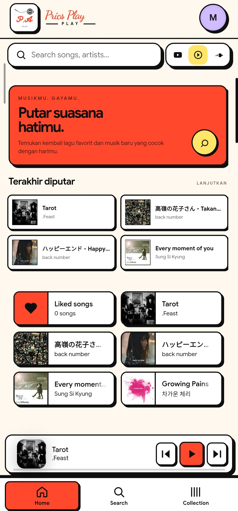
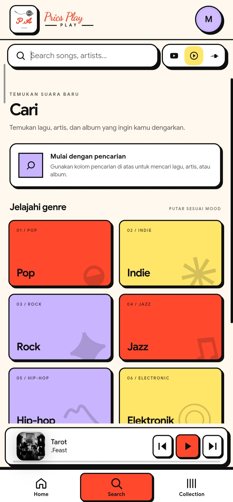
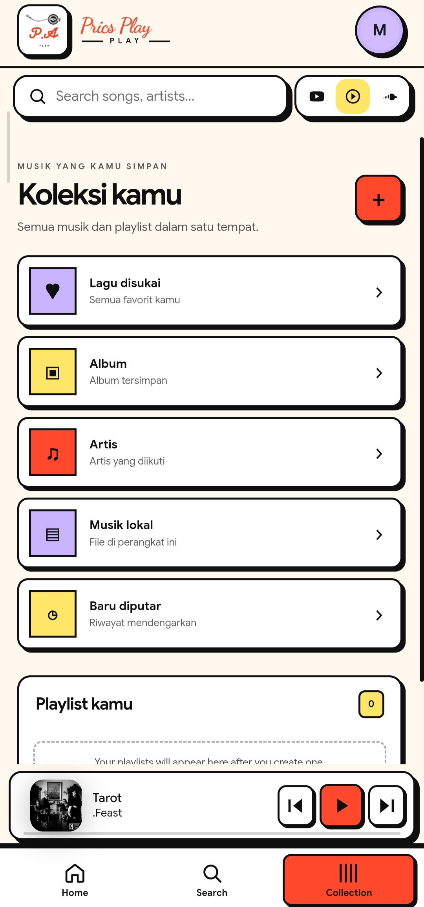
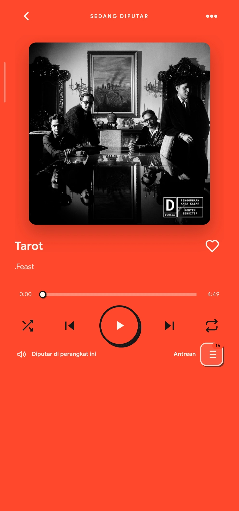

# âš¡ Prics Play

> Lightweight, independent music player with authentic Neubrutalism design for Android & Web PWA.

---

## 📱 Screenshots

  
  
  
  

---

## 🚀 Akses & Instalasi

| Platform | Format | Cara Pakai | Tautan |
| :--- | :--- | :--- | :--- |
| **Android** | `.apk` | Download & pasang langsung di HP Android | [Download APK](https://github.com/redhozr21/prics-neubrutalism-android/releases/latest) |
| **Web PWA** | Web App | Buka langsung di browser (iOS Safari, PC / Mac, Android) | [Buka Prics Play Web](https://redhozr21.github.io/prics-neubrutalism-android/) |

> **Catatan untuk pengguna iOS (iPhone / iPad):** Buka link Web PWA di Safari, lalu ketuk tombol Share (Bagikan) dan pilih **"Add to Home Screen"** untuk pengalaman layar penuh tanpa sideloading.

---

## 🎨 Fitur Utama
- **âš¡ Authentic Neubrutalism UI:** Tampilan bold dengan 2px black border, drop shadow 2px, dan warna khas Spotify-inspired.
- **âš¡ Web & Mobile Responsive:** Mendukung tampilan desktop presisi untuk PC/Mac serta tampilan mobile elegan di smartphone.
- **âš¡ Cache-First Offline Start:** Begitu dibuka langsung menampilkan data terakhir tanpa blank screen atau delay.
- **âš¡ Lirik Romaji Latin Otomatis:** Tombol toggle `RO` untuk menerjemahkan lirik Kanji/Hangul ke huruf alfabet murni.
- **âš¡ Download Album Lengkap:** Unduh seluruh isi album sekali klik dengan deteksi lewati lagu yang sudah ada.
- **âš¡ My Wave & Mixes On-Demand:** Rekomendasi pintar YouTube Music & Last.fm yang hemat kuota dan baterai.
- **âš¡ Blokir Lagu & Artis:** Bebas sensor konten yang tidak disukai langsung dari menu titik tiga.
- **âš¡ Multi-Device Sync:** Sinkronisasi playlist dan track favorit antar perangkat secara instan.